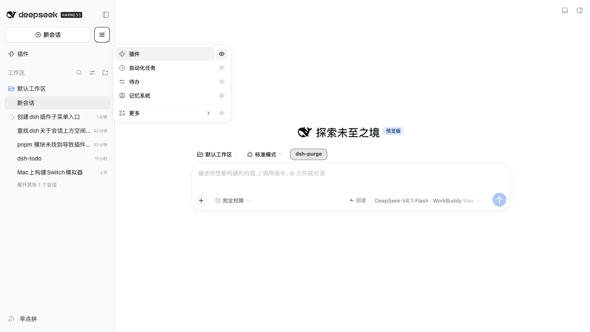

# dsh-sidebar-dock

Moves the DSH sidebar's panel list (`插件`, `自动化任务`, plugin-contributed panels, and `更多`) into a single dropdown anchored beside `新会话`.

The original panel list is folded by default. The dropdown mirrors every live `sidebar.panellist` registration, preserves each plugin's own icon markup, and includes the More-menu actions (`浏览更多插件`, `创建你的插件`). Each menu row has an eye button on the right: click it to pin that panel back into the sidebar; click again to fold it away. Pinned choices are stored in `localStorage` under `dsh-sidebar-dock:pinned`. New Session remains a split button: its existing button content is cloned and forwarded to the original action.
